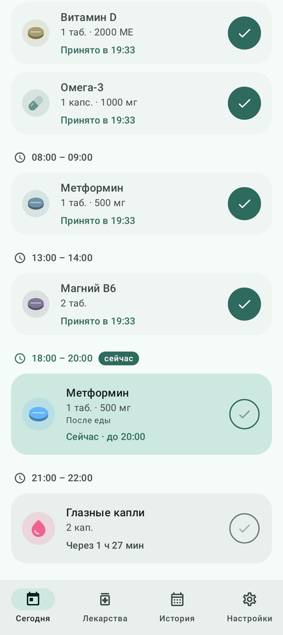
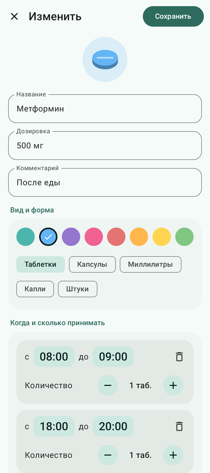
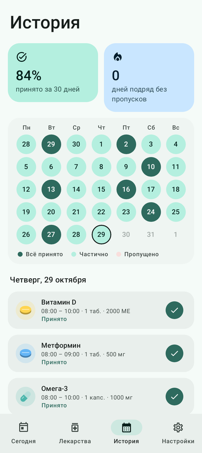
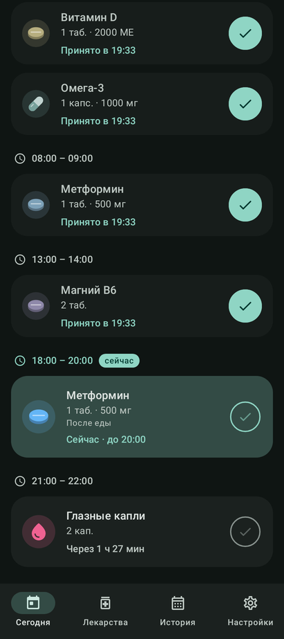

# Таблетки

Трекер приёма таблеток для Android (сделан под Pixel 9, работает на Android 8.0+).
Kotlin, Jetpack Compose, Material 3 — цвета подстраиваются под обои (Material You), есть тёмная тема.

<p>
  
  
  
  
</p>

## Что умеет

- **Окна приёма.** У каждого лекарства один или несколько приёмов в день, у каждого — желательное окно
  («с 08:00 до 10:00»). Окно может переходить через полночь.
- **Количество.** Сколько принимать за раз — отдельно для каждого приёма, с шагом ½ для таблеток и мл.
  Форма: таблетки, капсулы, мл, капли, штуки. Плюс дозировка («500 мг») и комментарий («после еды»).
- **Дни недели.** Каждый день, по будням или любые выбранные дни.
- **Напоминания.** Уведомление в начале окна, повторы каждые N минут, пока приём не отмечен
  и окно открыто, и тихая отметка «Не отмечено», когда окно закончилось. Прямо в уведомлении —
  кнопки «Принял», «Через 15 мин» и «Пропустить». Напоминания переживают перезагрузку телефона.
- **Запас.** По желанию: сколько осталось в упаковке; уменьшается при каждом приёме,
  а когда остаётся мало — предупреждение.
- **История.** Календарь за 5 недель, процент принятого за 30 дней и серия дней без пропусков.
  Прошлые приёмы можно отметить задним числом.
- **Настройки.** Интервал повторов (или без повторов), длительность «Отложить», проверка разрешений
  и тестовое уведомление.

Все данные хранятся только на телефоне (Room/SQLite).

## Установка на телефон

1. Скачайте APK: вкладка **Actions** → последний успешный запуск **Build** → артефакт `pills-apk`
   (или соберите сами, см. ниже).
2. Откройте файл на телефоне и разрешите установку из этого источника.
3. При первом запуске разрешите уведомления — иначе напоминания не придут.

APK подписан ключом `app/sideload.keystore` из репозитория. Он не секретный и нужен только для того,
чтобы новые версии, собранные где угодно, ставились поверх старой без потери данных.
Для публикации в Google Play нужен свой ключ.

## Сборка

Нужны JDK 17+ и Android SDK (platform 35).

```bash
./gradlew assembleRelease          # app/build/outputs/apk/release/app-release.apk
./gradlew testDebugUnitTest        # тесты логики расписания
```

## Устройство кода

| Пакет | Что внутри |
| --- | --- |
| `data` | Room: лекарства, окна приёма, журнал; `PillsRepository` — все изменения и перепланирование напоминаний |
| `domain` | `Schedule` — чистая логика: какие приёмы ожидаются в день, их статус, время следующего напоминания |
| `reminders` | `AlarmManager` (точные будильники), уведомления с кнопками, восстановление после перезагрузки |
| `ui` | Экраны на Compose: «Сегодня», «Лекарства», редактор, «История», «Настройки» |
